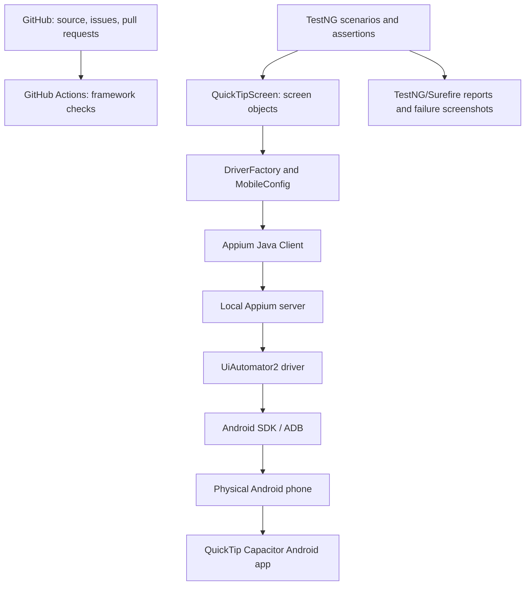

# Mobile QA Automation Architecture — QuickTip

**Owner:** AdmiralCoder QA Automation Portfolio  
**System under test:** QuickTip Android (Capacitor hybrid app)  
**Repository:** [appium-mobile-framework](https://github.com/admiralcoder-dev/appium-mobile-framework)  
**Status:** Existing framework scaffold; physical-device execution and functional selectors still require validation.

## Goals

- Demonstrate maintainable Android UI test automation on a **real Android phone**.
- Validate tip calculation, bill splitting, app launch, offline use, and accessibility in progressive milestones.
- Publish reproducible QA artifacts: test strategy, scenarios, defect reports, execution evidence, and CI results.
- Preserve production QuickTip; prefer a separate development/test APK for debugging.

## System architecture

## Repository layers

| Layer | Current implementation | Responsibility |
| --- | --- | --- |
| Test scenarios | `src/test/java/.../tests/QuickTipAndroidTest.java` | Business assertions and test intent |
| Screen object | `src/main/java/.../screens/QuickTipScreen.java` | Reusable UI interactions; no assertions |
| Device configuration | `src/main/java/.../config/MobileConfig.java` | Read app/device/server settings from environment |
| Driver management | `src/main/java/.../driver/` | Create, own, and close Appium sessions |
| Test lifecycle | `src/test/java/.../support/MobileTestBase.java` | Setup/teardown |
| Evidence | `ScreenshotListener.java` and Surefire | Failure screenshots and results |
| CI | `.github/workflows/appium.yml` | Currently runs **framework-only** tests, not Android device tests |

## Important: hybrid app testing

QuickTip is a **Capacitor Android app** with a WebView. We must inspect the actual app's accessibility tree before selecting elements.

- **NATIVE_APP context:** UiAutomator2 can inspect and interact with Android-accessible elements.
- **WEBVIEW context:** DOM-based locators may be preferable if a debuggable test build exposes a WebView and compatible Chromedriver is available.
- Do **not** assume CSS IDs are Appium accessibility IDs, or that a production build exposes WebView debugging.
- Prefer stable accessibility IDs/content descriptions or intentional test IDs, and verify selectors on the actual device.
- Keep any test-only WebView debugging in the **development/test build**; do not modify the released app just for automation.

## Environments and application boundaries

| Environment | Android package | Use |
| --- | --- | --- |
| Production | `com.admiralcoder.quicktip` | Published app; avoid destructive experiments |
| Development | `com.admiralcoder.quicktip.dev` | Preferred target for instrumentation and test changes |

The package values are project-specific. Confirm the actual installed package and launch activity using ADB before configuring a test session. No signing keys, passwords, keystores, or private APKs belong in this public repository.

## Execution tiers

1. **Framework checks (existing CI):** Java compilation, configuration tests, capability tests; no device.
2. **Real-device smoke (not yet verified):** ADB detection, Appium session, launch, visible UI.
3. **Functional regression (planned):** Correct tip amounts, custom percentages, splitting, invalid inputs, reset.
4. **Resilience and accessibility (planned):** Offline, lifecycle, orientation, display sizes, screen-reader accessibility.
5. **Emulator CI (future):** Only after stable real-device tests and an appropriately distributable test APK exist.

## Quality gates

- Every functional test must have an explicit expected result.
- Tests must fail clearly on incorrect calculations; unverified selectors should **skip**, not pass.
- Avoid hard-coded device IDs, secrets, private paths, and production credentials.
- Capture reproducible steps and screenshots for failures.
- Track execution date, device model, Android version, app version, and pass/fail/skip counts.
- Keep a clean separation between app implementation and independent QA automation.

## Roadmap

- **M1 — Environment:** Verify Windows, Java, Maven, Node, Android SDK, ADB, Appium compatibility.
- **M2 — Smoke:** Launch QuickTip on a real phone and capture first actual run.
- **M3 — Functional:** Verify locators and automate 15% tip and split scenarios.
- **M4 — Reporting:** Attach reproducible evidence, negative tests, and defect reports.
- **M5 — CI:** Evaluate an Android emulator job without conflating it with framework-only CI.

See [LOCAL_SETUP_WINDOWS.md](LOCAL_SETUP_WINDOWS.md), [QUICKTIP_TEST_PLAN.md](QUICKTIP_TEST_PLAN.md), and [PORTFOLIO_CASE_STUDY.md](PORTFOLIO_CASE_STUDY.md).
